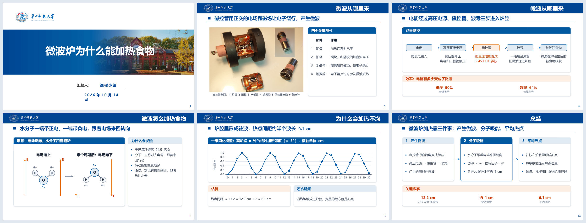

# hust-academic-ppt

用于 [Claude Code](https://claude.com/claude-code) 的 skill：按学术汇报模板生成组会、阶段汇报、开题、中期、答辩、课程报告的 PPT。
默认用华中科技大学模板，`templates/` 下可以放多套模板。



- **正文全部可编辑**：卡片、流程、节点图、表格、图表都是 PowerPoint 原生形状，图表数据可以在 PowerPoint 里改，不用整页图片。
- **先定内容再排版**：材料 → 叙事 → 页计划 → 生成脚本 → 质检。每页标题写结论句，正文给证据，页面上的数字要能在材料里找到出处。
- **统一的视觉规格**：颜色按含义使用（主色、强调、次要、错误、六类知识点类型色），字号三档，用 12 × 6 网格排版；
  在模板基础上每页先定主角，有图时让图够大，`references/layouts.md` 给出判断标准和例子。
- **程序质检加渲染目检**：`qa_check.py` 检查文字溢出、文字压图、配色、近似错位、构图重复、图片分辨率、数字出处、AI 套话；
  `render.py` 用 LibreOffice 或 PowerPoint 逐页出图，`sheet.py` 把几种排法拼成对照图。
- **取图工具**：从 Wikimedia Commons 检索下载，从论文 PDF 裁子图，把代码和终端输出渲染成截图；
  百度、公众号等网站的图可以用 `add` 下载，来源记在图片旁的 `.json` 里。

## 安装

把仓库克隆到 Claude Code 的 skills 目录：

```bash
git clone https://github.com/yangzz1125/hust-academic-ppt.git ~/.claude/skills/hust-academic-ppt
```

依赖：

| 用途 | 需要 |
|---|---|
| 生成和质检 | [uv](https://docs.astral.sh/uv/)（脚本用 `uv run --with python-pptx ...` 临时装依赖），Python 3.11+ |
| 渲染目检 | LibreOffice 和 pdftoppm（Poppler）；交付前用 PowerPoint 渲染一次（Windows） |
| 公式图片 | LaTeX（standalone 编译）和 pdftoppm |

`render.py` 默认在 `C:/Program Files/LibreOffice/program/soffice.exe` 找 LibreOffice，装在别处时改 `SOFFICE`。

## 使用

在 Claude Code 里直接说要做什么，例如：

> 用华科模板做一份 15 分钟的组会进展汇报，材料在 `reports/week6/`。

Claude 会读材料、给出页计划，确认后写生成脚本、跑质检、逐页渲染检查。生成脚本大致是：

```python
import sys
sys.path.insert(0, r"<skill 目录>/scripts")
from hust_deck import *

deck = Deck("hust")
deck.cover("微波炉为什么能加热食物", "课程小组", "2026年10月14日")
deck.toc(["微波从哪里来", "微波怎么加热食物", "为什么会加热不均"])
deck.divider("微波从哪里来")
c = deck.content("微波从哪里来", "磁控管让电子绕行掠过谐振腔，像吹哨一样激发微波", notes="口播稿……")
g = Grid()
c.web_figure("figures/magnetron.jpg", g.box(0, 0, 5, 6), "1 阴极 2 阳极 3 永磁体 4 谐振腔 5 输出线 6 输出针")
...
deck.save("deck.pptx")
```

完整示例见 `examples/microwave/build_deck.py`（上图就是它生成的），规范见 `SKILL.md` 和 `references/`。

## 目录

```
SKILL.md                 skill 入口：流程、视觉规格、API、质检
references/              内容规范、版式（以图为主、构图、并列页排法）、取图规范、模板说明
templates/<模板名>/      template.pptx（4 页版式）+ template.json（主色、正文区等参数）
scripts/                 hust_deck.py 生成库、qa_check.py 质检、render.py 渲染、取图和截图工具、template_check.py
examples/                阶段汇报骨架、完整的微波炉课程汇报、以图为主的几种排法示例
```

## 添加模板

准备一份 4 页的 PPT（封面、目录、过渡页、内容页），把要填字的形状按约定命名，写一个 `template.json`，
再用 `scripts/template_check.py` 检查。步骤和字段说明见 [`references/templates.md`](references/templates.md)。

## 许可

代码和文档按 [MIT](LICENSE) 发布。模板中的华中科技大学校徽和校名、示例里的维基百科文本和 Commons 图片按各自来源的许可使用，
见 [`NOTICE.md`](NOTICE.md)。
